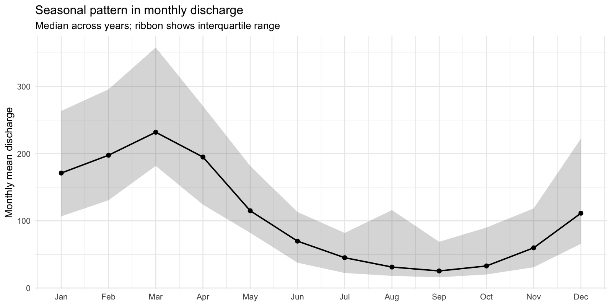
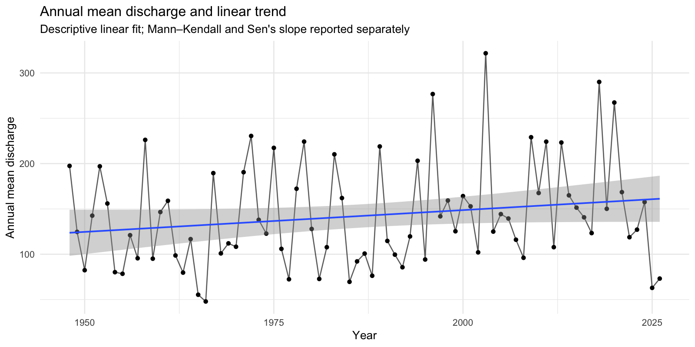
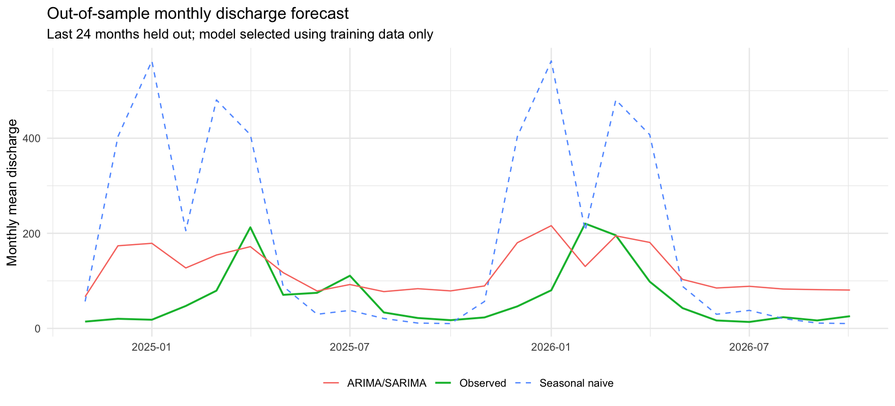

# RiverWatch: River Discharge Time-Series Analysis in R

[](https://github.com/alessiamaraca/riverwatch-time-series/actions/workflows/r-check.yml)

An R project exploring long-term trends, seasonal patterns, change points, anomalies, and forecasting in river discharge data from the U.S. Geological Survey (USGS).

The project uses historical discharge measurements from the Choptank River in Maryland. I developed the workflow to practise time-series methods commonly used in environmental data analysis and to build a reproducible approach that could later be adapted to ecological datasets, including biodiversity and eDNA monitoring data.

For now, the analysis focuses on river discharge rather than biodiversity. Discharge provides useful information about hydrological conditions, but it cannot be used on its own to assess biodiversity or ecosystem health.

## Research questions

The analysis focuses on five questions:

1. How does river discharge vary throughout the year?
2. Has mean annual discharge changed over time?
3. Are there detectable shifts in the monthly discharge series?
4. How well can seasonal ARIMA models predict monthly discharge compared with a simple seasonal baseline?
5. Which months show unusually high or low discharge relative to the expected seasonal pattern?

## Data

The data come from the USGS monitoring station on the Choptank River near Greensboro, Maryland.

| Field | Description |
|---|---|
| Data source | U.S. Geological Survey (USGS) |
| Monitoring station | Choptank River near Greensboro, Maryland |
| Station ID | `01491000` |
| Variable | Mean daily discharge |
| Parameter code | `00060` |
| Statistic code | `00003` |
| Units | Cubic feet per second (ft³/s) |
| Period analysed | January 1948 – October 2026 |

Daily observations are downloaded using the USGS `dataRetrieval` R package.

The script retrieves the latest available data each time it runs. Information about the download, including dates and number of observations, is saved in `outputs/tables/data_manifest.csv`.

Useful links:

- [USGS Water Data API](https://api.waterdata.usgs.gov/)
- [dataRetrieval documentation](https://doi-usgs.github.io/dataRetrieval/)

## Running the analysis

The project was developed in R. R version 4.3 or later is recommended.

After downloading the repository, open the project in RStudio and run:

```r
source("run_all.R")
```

Alternatively, the scripts can be run individually:

```r
source("R/00_setup.R")
source("R/01_download_data.R")
source("R/02_prepare_data.R")
source("R/03_exploration.R")
source("R/04_trend_analysis.R")
source("R/05_change_points.R")
source("R/06_forecasting.R")
source("R/07_anomalies.R")
source("R/08_make_summary.R")
```

The first run requires an internet connection to download the USGS data and install any missing R packages.

## Analysis methods

The workflow includes:

- Data cleaning, quality checks, and aggregation of daily observations into monthly and annual means
- Exploratory plots and seasonal decomposition (STL)
- Mann–Kendall test and Sen's slope for long-term trends
- Generalized additive models (GAMs) to examine smooth temporal trends and seasonality
- PELT change-point detection on seasonally adjusted monthly discharge
- Seasonal ARIMA forecasting, evaluated against a seasonal-naive model
- Anomaly detection using the median absolute deviation (MAD)

## Results

The results below are from the analysis run in October 2026, using 28,788 daily observations collected between January 1, 1948, and October 26, 2026.

### Seasonal variation

Discharge follows a clear seasonal pattern. Flows are generally higher during late winter and early spring, while lower values are more common in late summer and early autumn.

There is also considerable variation between individual days, including occasional high-discharge events.



### Long-term trends

I used the Mann–Kendall test to assess whether annual mean discharge showed a consistent trend over time.

The results were:

| Statistic | Result |
|---|---:|
| Mann–Kendall tau | 0.1282 |
| p-value | 0.09533 |
| Sen's slope | +0.45115 ft³/s per year |

The positive Sen's slope suggests a slight increase in annual mean discharge over the study period. However, the Mann–Kendall test was not statistically significant at the 0.05 level.

There is therefore some indication of an upward tendency, but not enough evidence to establish a significant long-term monotonic trend.



### Change-point detection

I applied the PELT algorithm to the seasonally adjusted monthly discharge series to look for potential changes in its statistical behaviour.

No change points were identified with the settings used in this analysis.

This result depends on the method and penalty settings and does not necessarily mean that the river's discharge regime has remained unchanged.

### Forecasting

I compared a seasonal ARIMA model with a seasonal-naive baseline using a chronological training and test split.

| Model | MAE | RMSE | MAPE |
|---|---:|---:|---:|
| Seasonal naive | 145.0 | 225.0 | 368% |
| ARIMA/SARIMA | 70.5 | 81.2 | 249% |

The ARIMA model performed better than the seasonal-naive baseline on the test period, with lower MAE and RMSE values.

However, forecasting river discharge remains difficult because of its variability, particularly during periods of unusually high or low flow.

The high MAPE values also need to be interpreted carefully, as percentage errors can become very large when observed discharge is close to zero.



### Unusual observations

I used a robust anomaly-detection method to identify months with discharge values that differed substantially from the estimated trend and seasonal pattern.

A small number of months were flagged as unusual.

These observations may be worth investigating further, but the statistical analysis alone cannot determine whether they correspond to floods, droughts, measurement issues, or other environmental events.

## Outputs

Figures generated by the workflow are saved in `outputs/figures/`:

```text
01_daily_discharge.png
02_monthly_seasonality.png
03_annual_trend.png
04_gam_trend_seasonality.png
05_change_points.png
06_forecast_holdout.png
07_anomalies.png
```

Results and supporting information are saved in `outputs/tables/`:

```text
trend_results.csv
change_points.csv
forecast_metrics.csv
anomalies.csv
data_manifest.csv
```

A more detailed analysis is also available in the Quarto report, which can be rendered to:

`report/analysis_report.html`

## Limitations and next steps

This analysis uses data from a single monitoring station, so the results should not be generalized to other rivers without further investigation.

A few aspects would be worth exploring in future work:

- Testing how autocorrelation affects the trend results
- Examining extreme discharge events separately from monthly and annual averages
- Including precipitation, temperature, or other environmental variables
- Comparing discharge patterns across multiple monitoring stations
- Applying the same workflow to biodiversity or eDNA time-series data

The main aim of RiverWatch is to provide a practical, reproducible example of environmental time-series analysis in R. It is also a starting point for more detailed ecological analyses using appropriate biological observations.
